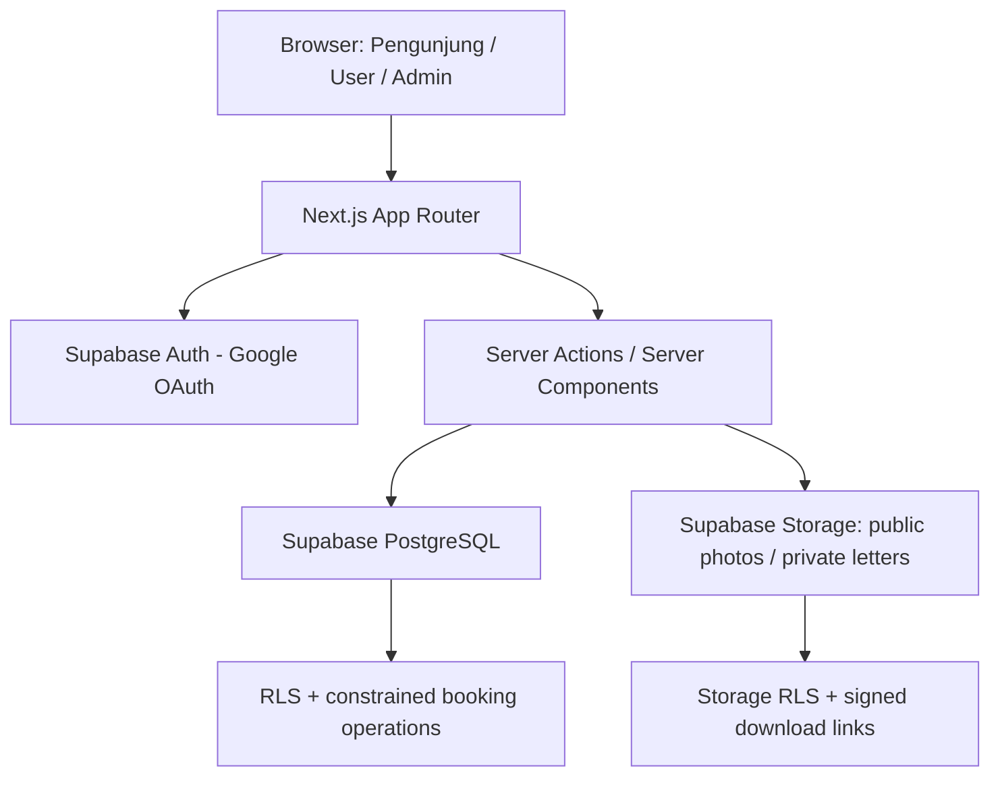
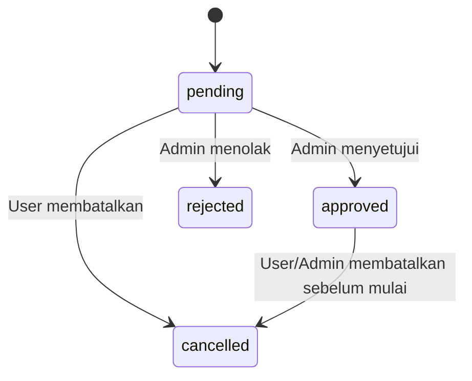
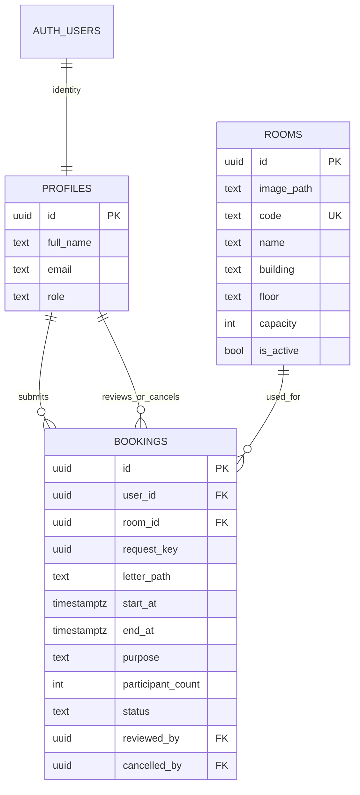

# PRODUCT REQUIREMENTS DOCUMENT (PRD)

# SPRK — Sistem Peminjaman Ruangan Kampus

**Versi:** 1.2 — Perluasan terkontrol: Surat Wajib & Foto Ruangan  
**Tanggal revisi:** 2 November 2026  
**Status:** Spesifikasi perubahan pada aplikasi yang telah berjalan; implementasi belum diverifikasi  
**Nama proyek Supabase:** `room-rental` (sudah dibuat oleh pemilik proyek)  
**Platform:** Responsive Web  
**Arsitektur:** Next.js App Router + Supabase (Auth + PostgreSQL + RLS + Storage)  
**Bahasa antarmuka:** Bahasa Indonesia  
**Zona waktu operasional:** `Asia/Jakarta` (WIB)

> **Aturan utama:** Bangun hanya fungsi peminjaman ruangan kampus. Tidak ada pembayaran, pembelian, penjualan, invoice, analitik dekoratif, chatbot, atau fitur tambahan di luar PRD ini. Panduan pengguna adalah bagian inti produk, bukan fitur opsional. Perubahan v1.2 hanya menambah **surat peminjaman PDF wajib** dan **satu foto utama ruangan opsional**. Semua fitur lama harus tetap berjalan.

> **Konteks implementasi:** versi v1.1 telah berjalan dengan login Google, role admin, serta pengajuan dan approval. Gunakan **migration tambahan non-destruktif**; jangan reset database, jangan membuat Supabase project baru, dan jangan menghapus booking/foto/dokumen pengguna yang sudah ada.

---

## 1. Ringkasan Produk

SPRK adalah aplikasi web sederhana bagi pengguna kampus untuk melihat ruangan, mengetahui jadwal yang sudah terpakai, mengajukan peminjaman, memeriksa status persetujuan, dan membatalkan peminjaman sesuai aturan. Admin mengelola informasi ruangan, memeriksa pengajuan, menyetujui/menolak pengajuan, membatalkan peminjaman yang disetujui, serta melihat jadwal.

### 1.1 Masalah yang diselesaikan

- Pengguna sulit mengetahui ruangan dan waktu yang masih tersedia.
- Pengajuan peminjaman tidak terdokumentasi dan statusnya tidak jelas.
- Pemesanan ganda berisiko terjadi saat admin memproses beberapa pengajuan.
- Pengguna baru memerlukan petunjuk langkah demi langkah.

### 1.2 Sasaran keberhasilan MVP

1. Pengunjung dapat memahami cara menggunakan sistem **sebelum login** melalui halaman Panduan.
2. Pengguna dapat menemukan ruangan, memeriksa jadwal, dan mengirim pengajuan dengan alur singkat.
3. Pengguna dapat melihat keputusan admin beserta alasan penolakan/pembatalan.
4. Admin dapat mengelola ruangan dan memutuskan pengajuan secara aman.
5. Database menjamin **tidak ada dua peminjaman `approved` dengan interval bertabrakan untuk ruangan yang sama**.
6. Desain konsisten, sederhana, responsif, dan tanpa elemen dekoratif yang tidak memiliki fungsi.
7. Setiap pengajuan baru wajib melampirkan **1 surat permohonan peminjaman dalam PDF** yang bisa diperiksa Admin sebelum mengambil keputusan.
8. Pengunjung/User dapat melihat **1 foto utama ruangan** (bila diunggah Admin) sebelum mengajukan.

### 1.3 Aktor

- **Pengunjung**: belum login; dapat melihat ruangan aktif, slot yang sudah terpakai, dan panduan. Pengunjung bukan role yang disimpan di database.
- **User**: akun Google terautentikasi dengan role `user` (misalnya mahasiswa/dosen/staf).
- **Admin**: akun Google terautentikasi dengan role `admin`, ditunjuk melalui proses database yang aman.

**Hanya ada dua role database: `user` dan `admin`.**

---

## 2. Keputusan Produk dan Batasan MVP

| Area | Keputusan final MVP |
|---|---|
| Autentikasi | Login Google melalui **Supabase Auth**, OAuth client dikelola di Google Cloud Console |
| Identitas | Nama dan email disinkronkan dari akun Google; tidak ada formulir registrasi lokal |
| Provisioning admin | Penunjukan manual di database oleh pengelola proyek; **tidak ada menu mendaftar sebagai admin** |
| Direktori | Bisa dilihat tanpa login; hanya ruangan aktif |
| Panduan | Halaman publik permanen `/panduan`, ditautkan dari navigasi dan alur peminjaman |
| Reservasi | User mengajukan; hanya admin bisa menyetujui/menolak |
| Konflik jadwal | Hanya `approved` memblokir slot; `pending` tidak mengunci slot |
| Durasi/jam operasional | Aturan tetap MVP (lihat §8), bukan sistem konfigurasi admin |
| Notifikasi | Status dicek di **Peminjaman Saya**; tidak ada email/WhatsApp/push notification |
| Admin landing | `/admin/peminjaman`, **tanpa dashboard metrik** |
| Foto ruangan | Maksimal **1 foto utama opsional** per ruangan; diunggah/diganti Admin; terlihat di detail publik |
| Surat peminjaman | **Wajib PDF** pada setiap booking baru; dipreview Admin sebelum menerima/menolak permohonan |
| Media | Supabase Storage: bucket publik untuk foto dan bucket privat untuk surat |
| Riwayat | Disimpan; tidak ada hard-delete ruangan/booking dari UI |
| Bahasa | Indonesia, waktu WIB |
| Keuangan | Sama sekali tidak ada harga, pembayaran, denda, atau invoice |

**Asumsi akses akun:** pada MVP, akun Google yang berhasil login dianggap dapat menjadi User. Login Google **tidak membuktikan secara otomatis** bahwa pemilik akun adalah civitas kampus. Jika kampus nantinya mewajibkan domain email atau daftar pengguna tertentu, itu merupakan perubahan kebijakan akses yang harus diputuskan sebelum rilis institusional; jangan diam-diam mengasumsikannya sekarang.

**Aturan jam/durasi pada PRD ini adalah kebijakan contoh yang ditetapkan untuk membuat MVP deterministik**, bukan klaim tentang peraturan resmi kampus. Konfirmasi kebijakan kampus sebelum digunakan sebagai sistem operasional sungguhan.

---

## 3. Teknologi dan Arsitektur

### 3.1 Stack yang wajib digunakan

| Lapisan | Teknologi | Kegunaan |
|---|---|---|
| Frontend + server aplikasi | **Next.js App Router**, TypeScript | Server Components, halaman, Server Actions, callback OAuth |
| Styling | **Tailwind CSS** | Utility styling sederhana dan responsif |
| Komponen UI | Komponen React sendiri / native HTML | Tidak perlu design system atau UI framework berat |
| Input validation | **Zod** | Validasi bentuk input pada server dan formulir |
| SDK | `@supabase/supabase-js` dan `@supabase/ssr` | Query Supabase, sesi berbasis cookie pada Next.js |
| OAuth | **Supabase Auth + Google Provider** | Login menggunakan Google Cloud OAuth Client |
| Database | **Supabase PostgreSQL** | `profiles`, `rooms`, `bookings` dengan kolom file path baru |
| Penyimpanan file | **Supabase Storage** | Bucket `room-images` (public) dan `booking-letters` (private) |
| Otorisasi | PostgreSQL **RLS**, Storage RLS, pemeriksaan role pada operasi server | Pembatasan data dan file user/admin |
| Keutuhan jadwal | PostgreSQL **exclusion constraint** + operasi transaksional | Mencegah double-approved booking secara atomik |
| Deployment (rekomendasi) | Vercel untuk Next.js, proyek Supabase yang sudah ada | Hosting aplikasi dan database |

Tidak menggunakan backend Laravel, Express, Prisma, MongoDB, Firebase, Supabase Realtime, ataupun Edge Functions. **Supabase Storage kini diperlukan secara khusus untuk dua fitur media v1.2**, tanpa layanan penyimpanan tambahan.

### 3.2 Alur sistem



1. Browser mengakses halaman Next.js.
2. Pengunjung melihat daftar ruangan/jadwal/panduan tanpa masuk.
3. Jika akan mengajukan peminjaman, user login melalui Supabase Auth dan Google.
4. Next.js memakai klien Supabase SSR dengan cookie session.
5. Operasi mutasi divalidasi pada server; database melakukan otorisasi dan validasi akhir.
6. Role `admin` dicek server-side/database untuk tindakan administratif.
7. Admin mengunggah satu foto utama per ruangan ke bucket publik `room-images`.
8. User mengunggah surat PDF ke bucket privat `booking-letters` sebagai bagian dari pengajuan; Admin hanya dapat membacanya setelah pemeriksaan role. Simpan **object path**, bukan URL bertoken, pada database.

### 3.3 Pola autentikasi Next.js

- Gunakan OAuth **PKCE** sesuai dokumentasi Supabase SSR.
- Buat Supabase browser client dan server client secara terpisah.
- Terapkan pembaruan cookie sesi mengikuti dokumentasi sesuai versi Next.js yang terpasang: `proxy.ts` untuk Next.js 16+; `middleware.ts` jika memakai Next.js 15 atau lebih lama.
- Callback aplikasi di `/auth/callback` memanggil `exchangeCodeForSession(code)` pada server, lalu mengarahkan pengguna ke halaman sesuai role.
- Validasi identitas di sisi server menggunakan API autentikasi yang memverifikasi pengguna/claims, bukan semata membaca payload dari penyimpanan browser.
- Semua redirect setelah login harus bersifat internal / sesuai allowlist agar tidak membuka **open redirect**.
- Jika login gagal, berikan pesan sederhana dan arahkan kembali ke `/login`.
- Setelah logout, session dihapus dan pengguna kembali ke `/ruangan`.

### 3.4 Variabel environment

Contoh `.env.local`:

```dotenv
NEXT_PUBLIC_SUPABASE_URL=https://<PROJECT_REF>.supabase.co
NEXT_PUBLIC_SUPABASE_PUBLISHABLE_KEY=<SUPABASE_PUBLISHABLE_KEY>
NEXT_PUBLIC_SITE_URL=http://localhost:3000
```

- Ambil Project URL dan **publishable key** dari dashboard Supabase proyek `room-rental`.
- Environment production memakai URL domain production.
- Google OAuth Client Secret disimpan di konfigurasi **Supabase Authentication > Providers > Google**, bukan di `NEXT_PUBLIC_*`.
- **Tidak diperlukan `SUPABASE_SERVICE_ROLE_KEY` di aplikasi web** untuk MVP. Tindakan admin operasional harus dijalankan melalui identitas admin yang terautentikasi dan aturan database, bukan service key publik.
- File `.env.local` tidak boleh di-commit.

### 3.5 Konfigurasi Google OAuth

1. Google Auth Platform / Google Cloud Console: buat OAuth Client bertipe **Web application**.
2. Authorized JavaScript origins: origin lokal, mis. `http://localhost:3000`, dan origin produksi saat tersedia.
3. Authorized redirect URI Google: salin **callback URL Supabase** dari konfigurasi Google provider. Umumnya `https://<PROJECT_REF>.supabase.co/auth/v1/callback`.
4. Supabase Dashboard > Authentication > Providers > Google: aktifkan provider, isi Client ID dan Client Secret.
5. Supabase Authentication > URL Configuration: atur Site URL; tambahkan aplikasi `/auth/callback` ke daftar Redirect URLs (localhost dan URL produksi).
6. Uji satu login Google baru, login ulang, logout, callback gagal, dan pemulihan sesi setelah refresh.

**Bedakan dua callback:** redirect Google menuju **Supabase Auth**; setelah itu Supabase kembali ke **callback Next.js** untuk menukar kode PKCE dan menyimpan sesi.

---

## 4. Information Architecture / Routes

| Route | Akses | Halaman / tujuan |
|---|---|---|
| `/` | Semua | Alihkan ke `/ruangan` |
| `/ruangan` | Publik | Daftar ruangan aktif + pencarian |
| `/ruangan/[id]` | Publik | Detail ruangan + jadwal waktu terpakai |
| `/panduan` | Publik | Panduan langkah demi langkah + FAQ |
| `/login` | Publik | Login Google |
| `/auth/callback` | Callback OAuth | Memproses code exchange dan redirect aman |
| `/peminjaman/baru?room=<uuid>` | User | Form pengajuan dan **unggah surat PDF wajib** (ruangan dipilih dari direktori) |
| `/peminjaman-saya` | User | Semua pengajuan milik sendiri |
| `/peminjaman-saya/[id]` | User | Detail, status, alasan, **surat terlampir** dan aksi pembatalan |
| `/admin/peminjaman` | Admin | Antrian peminjaman: default `pending` |
| `/admin/peminjaman/[id]` | Admin | Detail, **lihat surat PDF**, keputusan terima/tolak |
| `/admin/ruangan` | Admin | Daftar ruangan, ubah status |
| `/admin/ruangan/baru` | Admin | Form tambah ruangan |
| `/admin/ruangan/[id]/edit` | Admin | Form edit ruangan |
| `/admin/jadwal` | Admin | Jadwal approved per tanggal/ruangan |

Navigasi publik: **Ruangan · Panduan · Masuk**. Setelah login User: **Ruangan · Panduan · Peminjaman Saya · Keluar**. Navigasi admin: **Pengajuan · Ruangan · Jadwal · Keluar**. Semua operasi sensitif tetap membutuhkan verifikasi server/database walaupun route dan menu sudah dilindungi.

---

## 5. Functional Requirements — Pengunjung dan User

### FR-01 — Login Google (P0)

**Perilaku**
- Satu tombol **Masuk dengan Google**, tanpa login/password lokal, reset password, atau form registrasi.
- Setelah login pertama berhasil, profil dibuat otomatis dengan role `user` (kecuali akun sebelumnya sudah admin).
- Nama dan email dibaca dari akun autentikasi; User tidak dapat mengubah role atau identitas administratif.
- User login diarahkan ke tujuan semula bila aman/diizinkan; default `/ruangan`.
- Admin login diarahkan ke `/admin/peminjaman`.

**Acceptance Criteria**
- Pengguna baru memiliki profil tepat satu baris terkait `auth.users.id`.
- Tidak ada cara menjadi admin melalui UI, request, atau perubahan metadata Google.
- Route yang membutuhkan sesi mengarahkan pengguna anonim ke login.
- Logout mengakhiri sesi aplikasi.

### FR-02 — Daftar Ruangan (P0)

Tampilkan hanya ruangan aktif, berisi **nama, kode, gedung, lantai, kapasitas**, dan **Lihat Detail**. Sediakan input pencarian nama/kode; tidak ada filter kategori yang tidak dibutuhkan. Data diurutkan nama ruangan A–Z. Jika kosong, tampilkan state informatif. Foto ruangan bersifat opsional; tampilkan satu gambar kecil yang relevan jika ada. Tidak perlu carousel, galeri, rating, atau fasilitas tambahan yang tidak dicatat.

**Acceptance Criteria**
- Bisa dibuka sebelum login.
- Search bekerja tanpa harus memuat ulang seluruh aplikasi.
- Ruangan nonaktif tidak muncul pada daftar publik dan tidak bisa diajukan.
- Ada tautan jelas **Cara meminjam ruangan** menuju `/panduan`.

### FR-03 — Detail dan Ketersediaan Ruangan (P0)

Tampilkan seluruh data relevan ruangan: **satu foto utama jika tersedia**, nama, kode, gedung, lantai, kapasitas, deskripsi jika diisi. Pengunjung dapat memilih **tanggal** dan melihat daftar blok waktu yang **sudah disetujui** pada tanggal tersebut; tampilkan waktu WIB. Data jadwal publik hanya mengandung rentang waktu terpakai, **tanpa nama/email/keperluan peminjam**.

Ketersediaan merupakan **indikasi saat tampilan dibuka**, bukan jaminan peminjaman; selalu periksa ulang ketika pengajuan dikirim dan saat admin menyetujui.

**Acceptance Criteria**
- Rentang `08.00–10.00` dan `10.00–12.00` dianggap tidak bentrok.
- Hanya booking `approved` memblokir slot dalam tampilan ketersediaan.
- Tombol **Ajukan Peminjaman** membawa User ke form, sedangkan pengunjung diarahkan melalui login.
- Foto ruangan tampil pada detail tanpa login. Jika belum ada foto, tampilkan teks sederhana **Foto ruangan belum tersedia**, bukan gambar ilustratif buatan atau placeholder dekoratif.

### FR-04 — Form Pengajuan (P0)

| Kolom | Jenis | Syarat |
|---|---|---|
| Nama peminjam | Read-only | Nama akun Google |
| Email | Read-only | Email akun Google |
| Ruangan | Read-only | Berdasarkan ruangan terpilih |
| Tanggal | Date | Wajib, berlaku aturan §8 |
| Jam mulai | Time/select | Wajib, kelipatan 30 menit |
| Jam selesai | Time/select | Wajib, setelah jam mulai |
| Keperluan | Textarea | Wajib, 10–200 karakter setelah trim |
| Jumlah peserta | Number | Integer >= 1 dan <= kapasitas |
| **Surat permohonan** | **File PDF** | **Wajib**, tepat 1 file, `application/pdf`, maksimal 5 MB |

- Di bawah input surat, tampilkan teks **"Unggah surat permohonan peminjaman dalam format PDF (maks. 5 MB). Surat akan diperiksa admin."** dan nama file setelah dipilih.
- Surat dapat diganti sebelum tombol Kirim Pengajuan ditekan; setelah pengajuan terkirim, file surat tidak dapat diedit pada MVP (jika ditolak, buat pengajuan baru dengan surat yang benar).
- User dapat melihat/mengunduh surat miliknya sendiri melalui detail booking setelah submit.
- Tampilkan keterangan bahwa **pengajuan belum disetujui** sampai diputuskan admin.
- Tombol **Kirim Pengajuan** memiliki pending state untuk mencegah klik ganda; operasi server menerima `request_key` unik untuk idempotensi.
- Server mengabaikan user ID/status apa pun yang dikirim dari browser: `user_id` diambil dari sesi, status selalu `pending`.
- Server memverifikasi MIME dan signature PDF, ukuran, pemilik file, dan object path yang dikaitkan ke `request_key`; tidak boleh mempercayai path arbitrary dari browser.
- Upload berhasil **bukan** berarti booking berhasil. Operasi booking hanya menghasilkan status sukses setelah file valid dan row `bookings` berhasil dibuat. Jika submit gagal, lakukan cleanup file yatim (orphan) tanpa menghapus lampiran booking yang sudah berhasil.
- Periksa ulang waktu, kapasitas, status ruangan, benturan dengan `approved`, dan batas pengajuan.

**Acceptance Criteria**
- Invalid form menampilkan error dekat input tanpa menghapus data yang valid.
- Pengajuan valid menghasilkan satu booking `pending` dan mengarahkan ke detail Peminjaman Saya.
- Slot approved menolak pengajuan baru dengan pesan **"Jadwal sudah digunakan. Pilih waktu lain."**
- Dua request identik dengan `request_key` yang sama tidak menghasilkan dua booking **atau dua surat**.
- Submit tanpa surat / PDF rusak / tipe tidak valid / berukuran >5 MB ditolak dengan pesan spesifik.
- Database menyimpan referensi ke object Storage privat; URL publik surat tidak pernah tersedia.

### FR-05 — Peminjaman Saya (P0)

Daftar pengajuan user sendiri, terbaru dahulu. Kolom: **ruangan, tanggal, rentang waktu, keperluan ringkas, status**. Aksi **Lihat Detail**. Detail menampilkan seluruh data, **tautan Lihat Surat Peminjaman** untuk surat sendiri, alasan jika ditolak/dibatalkan oleh admin, dan siapa yang membatalkan dalam bentuk label "Dibatalkan oleh Anda/Admin" tanpa mengekspos informasi yang tidak perlu.

Status yang ditampilkan:
- `pending` = **Menunggu**
- `approved` = **Disetujui**
- `rejected` = **Ditolak**
- `cancelled` = **Dibatalkan**

Jika waktu booking berstatus `approved` sudah lewat, status database tetap `approved` dan UI menambahkan keterangan **Waktu penggunaan telah berakhir**. **Tidak perlu status `completed` atau job terjadwal.**

**Acceptance Criteria**
- User A tidak dapat melihat/memodifikasi booking User B.
- Tidak adanya booking menghasilkan empty state **Belum ada peminjaman** dengan tautan ke `/ruangan`.
- Riwayat booking ditolak/dibatalkan tetap terlihat.

### FR-06 — Pembatalan oleh User (P0)

User dapat membatalkan booking miliknya jika status `pending` atau `approved` **dan** waktu mulai belum lewat. Wajib dialog konfirmasi. Pembatalan menjadi `cancelled`, tidak dapat dibatalkan ulang, tidak dapat dipulihkan, dan tidak menghapus row. Pengajuan kembali harus membuat booking baru.

**Acceptance Criteria**
- Pembatalan booking pihak lain ditolak server/RLS.
- Pembatalan yang sudah lewat waktu mulai ditolak.
- Pembatalan `approved` langsung melepaskan slot dari daftar terpakai.

---

## 6. Panduan Pengguna — Fitur Prioritas Utama

### FR-07 — Halaman Panduan (P0, wajib selesai sebelum alur booking dianggap siap)

**Penempatan**
1. Tautan **Panduan** di navigasi publik/User.
2. Tautan **Baru pertama kali? Baca panduan peminjaman** di atas daftar ruangan.
3. Tautan **Bagaimana cara meminjam?** di halaman login.
4. Tautan teks **Lihat panduan** di form booking.

**Isi halaman wajib, berurutan:**

**1. Cari ruangan** — Buka menu Ruangan, temukan ruangan berdasarkan nama, lokasi, dan kapasitas.

**2. Periksa jadwal** — Buka detail ruangan, pilih tanggal, lalu lihat jam yang sudah terpakai. Pilih jam yang belum terisi.

**3. Login, isi form, dan unggah surat** — Masuk dengan Google, lengkapi keperluan, tanggal, jam, jumlah peserta, kemudian **unggah 1 surat PDF wajib (maks. 5 MB)**. Setelah itu pilih Kirim Pengajuan.

**4. Tunggu pemeriksaan surat dan persetujuan** — Status awal **Menunggu**. Admin memeriksa surat dan detail peminjaman; **Menunggu bukan berarti ruangan sudah dipesan**.

**5. Cek hasil** — Buka **Peminjaman Saya**. Jika **Disetujui**, surat dan pengajuan diterima; jika **Ditolak**, baca alasan (misalnya surat tidak sesuai) lalu ajukan ulang; jika **Dibatalkan**, booking tidak berlaku.

**Penjelasan status**

| Status | Arti sederhana |
|---|---|
| Menunggu | Pengajuan diterima sistem dan belum diperiksa/disetujui admin. |
| Disetujui | Ruangan telah dialokasikan untuk tanggal dan jam tersebut. |
| Ditolak | Admin tidak menyetujui pengajuan; baca alasannya. |
| Dibatalkan | Pengajuan tidak berlaku lagi. |

**FAQ wajib**

1. **Haruskah login untuk melihat ruangan?** Tidak. Login baru diwajibkan saat mengajukan.
2. **Apakah pengajuan langsung disetujui?** Tidak. Admin yang memutuskan.
3. **Di mana melihat status?** Di halaman Peminjaman Saya.
4. **Bagaimana jika slot sudah digunakan?** Pilih tanggal atau jam lain.
5. **Bagaimana jika ditolak, misalnya karena surat tidak sesuai?** Baca alasan di detail, perbaiki surat, lalu buat pengajuan baru.
6. **Apakah pengajuan bisa dibatalkan?** Bisa sebelum waktu mulai, jika status masih Menunggu atau Disetujui.

**Catatan panduan yang wajib tampil:** surat **PDF adalah syarat wajib pengajuan**, bukan surat otomatis yang dibuat sistem; foto ruangan hanyalah referensi kondisi ruangan. Jika tidak ada surat, pengguna tidak bisa mengirim permohonan.

Bagian akhir halaman berisi satu CTA: **Lihat Daftar Ruangan**. Gunakan teks singkat dan struktur bernomor; **tanpa video tutorial, chatbot, walkthrough pop-up, slideshow, ataupun ilustrasi wajib**.

**Acceptance Criteria**
- Panduan bisa dibaca tanpa login di desktop dan mobile.
- Seluruh alur 5 langkah, penjelasan 4 status, dan 6 FAQ tersedia.
- Pengguna dapat menuju daftar ruangan dalam satu klik dari panduan.
- Pesan pada form dan panduan konsisten mengenai sifat approval-based.

---

## 7. Functional Requirements — Admin

### FR-08 — Manajemen Ruangan (P0)

Admin dapat membuat, mengedit, mengaktifkan, dan menonaktifkan ruangan. **Tidak ada hapus permanen**.

| Field | Wajib | Aturan |
|---|---|---|
| `code` | Ya | Unik, 2–30 karakter, huruf/angka/tanda `-`, tidak case-sensitive |
| `name` | Ya | 3–100 karakter |
| `building` | Ya | 2–100 karakter |
| `floor` | Ya | 1–30 karakter (teks, mis. `1`, `Basement`) |
| `capacity` | Ya | Integer 1–1000 |
| `description` | Tidak | Maks. 500 karakter |
| `is_active` | Ya | Default `true` |
| `image_path` | Tidak | 1 foto utama; JPEG/PNG/WebP, maksimum 3 MB |

**Aturan**
- Ruangan nonaktif tidak menerima booking baru dan pending-nya tidak dapat disetujui.
- Status nonaktif **tidak otomatis membatalkan** booking `approved` yang masih ada; admin menangani booking yang terdampak dengan pembatalan manual dan alasan.
- Jangan izinkan penurunan kapasitas di bawah jumlah peserta pada booking `approved` yang belum berakhir.
- `code` tetap unik walau ruangan sedang nonaktif.
- Field wajib divalidasi di server dan dilindungi constraint database.
- Admin dapat **unggah, lihat preview, ganti, atau hapus foto** dari form tambah/edit ruangan. Satu ruangan maksimal satu foto utama; foto bukan syarat mengaktifkan ruangan.
- File gambar hanya menerima `image/jpeg`, `image/png`, atau `image/webp`, maksimal 3 MB; validasi isi file, bukan hanya ekstensi.
- Ganti foto menggunakan **object path baru** agar tidak ada cache gambar lama; hapus file lama setelah database berhasil diupdate. Jika operasi gagal, lakukan cleanup file yatim.
- User/anon hanya dapat **melihat** foto, tidak dapat mengunggah, mengganti, atau menghapusnya.

### FR-09 — Administrasi Peminjaman (P0)

Halaman utama admin adalah `/admin/peminjaman`. Tampilkan daftar pengajuan dengan nama peminjam, ruangan, tanggal, jam, peserta, status dan tindakan **Lihat Detail**.

- Default filter **Menunggu**, urut waktu pengajuan terlama terlebih dahulu.
- Filter tambahan: Semua, Disetujui, Ditolak, Dibatalkan.
- Detail menampilkan identitas peminjam, keperluan, data ruangan, tanggal/jam, peserta, status, serta **nama berkas dan tombol Lihat Surat PDF**.
- **Surat PDF wajib diperiksa Admin sebelum mengambil keputusan**. Admin membuka preview di tab baru atau mengunduh PDF; jangan memasang PDF viewer berat/kompleks.
- **Keputusan persetujuan/penolakan booking sekaligus merupakan keputusan terhadap surat**. Tidak perlu status dokumen tambahan, tombol terima surat terpisah, atau workflow persetujuan ganda.
- Untuk booking `pending`: tampilkan **Setujui** dan **Tolak**.
- Untuk booking `approved` yang belum dimulai: tampilkan **Batalkan**.
- Booking `rejected`/`cancelled` hanya bisa dilihat.

**Setujui**
- Wajib konfirmasi.
- Server/database memeriksa status masih `pending`, **lampiran surat PDF ada dan terhubung sah ke booking**, waktu mulai belum lewat, ruangan masih aktif, jumlah peserta masih sesuai, dan tidak ada konflik `approved`.
- Proses atomik; satu admin tidak dapat menimpa keputusan admin lainnya.
- Jika berhasil status `approved`, `reviewed_by` dan `reviewed_at` tercatat.
- Jika gagal karena bentrok, status tetap `pending`, tampilkan pesan dan arahkan admin untuk menolak dengan alasan jika diperlukan.

**Tolak**
- Hanya dari `pending`.
- Alasan wajib 10–300 karakter; boleh menjelaskan ketidaksesuaian/ketidaklengkapan surat.
- Simpan `review_note`, `reviewed_by`, `reviewed_at`.
- Hasil akhir `rejected` dan tidak bisa diubah kembali.

**Batalkan oleh Admin**
- Hanya `approved` **yang belum dimulai**.
- Alasan wajib 10–300 karakter, terlihat pada detail booking User.
- Simpan `cancelled_by`, `cancelled_at`, `cancellation_reason`.
- Hasil akhir `cancelled`; slot langsung dilepaskan.
- Jika ruangan telah digunakan/dimulai, admin tidak mengubah histori masa lalu melalui UI MVP.

### FR-10 — Jadwal Admin (P0)

Halaman `/admin/jadwal`: pilih tanggal dan opsional ruangan, lalu tampilkan **hanya booking `approved`** yang terkait, diurutkan nama ruangan lalu waktu mulai. Tidak membutuhkan kalender bulanan atau drag-and-drop. Akses hanya Admin.

---

## 8. Business Rules (BR)

Aturan operasional MVP bersifat **tetap di kode/database** (bukan pengaturan yang dapat diedit Admin). Ketentuan berikut menjadi target test yang eksplisit:

| ID | Ketentuan |
|---|---|
| BR-01 | Semua pengajuan dibuat oleh user yang login dan tersimpan dengan identitas user tersebut. |
| BR-02 | Booking baru selalu `pending`; keputusan hanya oleh admin. |
| BR-03 | Rentang waktu operasional: **07.00–21.00 WIB**, mulai dan selesai dalam hari kalender yang sama. |
| BR-04 | Durasi minimal **30 menit** dan maksimal **4 jam**. |
| BR-05 | Waktu mulai dan selesai harus pada kelipatan **30 menit**. |
| BR-06 | Pengajuan baru mulai minimal **30 menit dari waktu saat request diproses**. |
| BR-07 | Pengajuan bisa dibuat mulai tanggal hari ini sampai **30 hari kalender ke depan** (inklusif) dalam WIB. |
| BR-08 | Satu pengajuan untuk **satu ruangan dan satu rentang waktu pada satu tanggal**. |
| BR-09 | Peserta adalah integer ≥ 1 dan ≤ kapasitas ruangan aktif. |
| BR-10 | Hanya booking `approved` yang memblokir rentang waktu. |
| BR-11 | Tidak ada dua booking `approved` yang overlap pada ruangan yang sama, termasuk jika dua admin setuju hampir bersamaan. |
| BR-12 | `pending` bisa menggunakan slot yang sama dengan `pending` lainnya; approval pertama yang berhasil akan menghalangi approval lainnya. |
| BR-13 | Pemohon boleh membatalkan `pending`/`approved` miliknya **sebelum waktu mulai**. |
| BR-14 | Admin hanya boleh menolak `pending` dan membatalkan `approved` yang belum dimulai dengan alasan. |
| BR-15 | Booking tidak diedit atau dipindahkan; jika salah waktu, batalkan lalu buat baru. |
| BR-16 | Riwayat tidak dihapus secara permanen melalui UI. |
| BR-17 | Waktu disimpan sebagai `timestamptz` UTC dan disajikan sebagai WIB. |
| BR-18 | Booking dengan waktu mulai sudah terlewati tidak dapat disetujui. |
| BR-19 | Setiap **booking baru** wajib memiliki satu surat PDF valid maksimal 5 MB dalam bucket privat. |
| BR-20 | Admin memutuskan terima/tolak surat **bersama keputusan booking**, bukan status terpisah. |
| BR-21 | Surat tidak boleh dibaca pengunjung, user lain, atau melalui public URL. Hanya pemilik booking dan Admin berwenang. |
| BR-22 | Foto ruangan maksimal satu per ruangan, bersifat opsional; hanya Admin boleh mengubahnya. |
| BR-23 | Upload dokumen dan gambar hanya tipe terizinkan; jangan percaya MIME/ekstensi dari klien. |
| BR-24 | Booking lama yang sudah ada dipertahankan, walaupun `letter_path` null. Booking baru setelah penerapan wajib melampirkan surat. Booking pending lama tanpa surat tidak boleh di-approve sampai diajukan ulang sesuai prosedur terbaru. |

**Formula bentrok:** `A.start_at < B.end_at AND A.end_at > B.start_at` pada `room_id` yang sama dan status `approved`.

Contoh: `08:00–10:00` dengan `09:00–11:00` = bentrok; dengan `10:00–12:00` = tidak bentrok.

**Transisi status yang diizinkan:**



TIDAK ada: status `completed`, `expired`, `in_use`, auto-approval, atau fitur pemindahan jadwal.

---

## 9. Database: Skema dan Keutuhan Data

Semua tabel aplikasi berada di schema `public`; akun Google dikelola Supabase dalam `auth.users`.

### 9.1 Tabel `profiles`

| Kolom | Tipe | Ketentuan |
|---|---|---|
| `id` | `uuid` PK, FK `auth.users(id)` | `ON DELETE CASCADE` sesuai kebijakan pemulihan akun |
| `full_name` | `text not null` | Nama Google; fallback nilai aman saat metadata kosong |
| `email` | `text not null` | Email login |
| `role` | `text not null default 'user'` | CHECK (`user`, `admin`) |
| `created_at` | `timestamptz not null` | Default `now()` |
| `updated_at` | `timestamptz not null` | Dipelihara server/trigger |

- Provisioning melalui trigger aman setelah akun Auth dibuat dan backfill untuk akun yang sudah ada jika diperlukan.
- Trigger/handler pembaruan metadata hanya boleh mengubah `full_name`/`email`, **tidak pernah `role`**.
- Untuk mencegah spoofing, klien tidak diberi izin update langsung pada `profiles.role`.
- Admin ditetapkan melalui SQL administratif yang dieksekusi pemilik proyek, bukan endpoint publik.

### 9.2 Tabel `rooms`

| Kolom | Tipe | Ketentuan |
|---|---|---|
| `id` | `uuid` PK | Default `gen_random_uuid()` |
| `code` | `text not null` | Unik case-insensitive, normalisasi trim + uppercase |
| `name` | `text not null` | 3–100 karakter |
| `building` | `text not null` | Gedung |
| `floor` | `text not null` | Lantai |
| `capacity` | `integer not null` | CHECK `between 1 and 1000` |
| `description` | `text null` | Maks. 500 |
| `is_active` | `boolean not null` | Default `true` |
| `image_path` | `text null` | Object path foto utama pada bucket `room-images`; bukan URL |
| `created_at` | `timestamptz not null` | Default `now()` |
| `updated_at` | `timestamptz not null` | Trigger server |

Unik `code` case-insensitive dapat dipenuhi dengan unique index pada `upper(code)` dan validasi format kode; tidak perlu ekstensi `citext`.

### 9.3 Tabel `bookings`

| Kolom | Tipe | Ketentuan |
|---|---|---|
| `id` | `uuid` PK | Default `gen_random_uuid()` |
| `user_id` | `uuid not null` FK profiles | Pemohon |
| `room_id` | `uuid not null` FK rooms | Ruangan |
| `request_key` | `uuid not null` | Kunci idempotensi satu submit |
| `letter_path` | `text null` | Object path PDF pada bucket `booking-letters`; nullable **hanya untuk kompatibilitas booking lama** |
| `start_at` | `timestamptz not null` | Awal waktu |
| `end_at` | `timestamptz not null` | Akhir waktu |
| `purpose` | `text not null` | 10–200 karakter |
| `participant_count` | `integer not null` | >= 1 |
| `status` | `text not null` | CHECK pending/approved/rejected/cancelled; default pending |
| `reviewed_by` | `uuid null` FK profiles | Admin yang memutuskan |
| `reviewed_at` | `timestamptz null` | Waktu keputusan |
| `review_note` | `text null` | Alasan penolakan |
| `cancelled_by` | `uuid null` FK profiles | User/admin pembatal |
| `cancelled_at` | `timestamptz null` | Waktu pembatalan |
| `cancellation_reason` | `text null` | Alasan wajib untuk admin |
| `created_at` | `timestamptz not null` | Default now() |
| `updated_at` | `timestamptz not null` | Trigger server |

**Constraint wajib:**
- CHECK `end_at > start_at`, `participant_count >= 1`, `status IN (...)`.
- UNIQUE (`user_id`, `request_key`) untuk idempotensi.
- Foreign keys yang menjaga integritas relasi.
- Tidak ada aksi hapus booking atau ruangan dari aplikasi.
- Untuk v1.2, **jangan menambahkan `NOT NULL` ke seluruh `bookings.letter_path`** karena booking lama sudah ada. Wajibkan surat dalam RPC `create_booking` terbaru, validasi server, dan pemeriksaan saat admin approval. Update RPC tanpa mengubah identitas atau status booking lama.
- Untuk mencegah double-approval, buat migration dengan **GiST exclusion constraint** (contoh logika; implementasi lengkap harus menyesuaikan migration):

```sql
CREATE EXTENSION IF NOT EXISTS btree_gist;

ALTER TABLE public.bookings
  ADD CONSTRAINT bookings_no_approved_overlap
  EXCLUDE USING gist (
    room_id WITH =,
    tstzrange(start_at, end_at, '[)') WITH &&
  ) WHERE (status = 'approved');
```

Constraint ini melindungi proses approval bersamaan pada level PostgreSQL, tidak hanya lewat pemeriksaan frontend. Tangkap error constraint dan tampilkan pesan benturan yang mudah dipahami.

**Indeks tambahan** (selain yang dibuat constraint):
- `(user_id, created_at DESC)` untuk Peminjaman Saya.
- `(status, created_at ASC)` untuk antrian admin.
- `(room_id, start_at)` untuk daftar jadwal.

### 9.4 ERD ringkas



### 9.5 Supabase Storage — dua bucket wajib (v1.2)

| Bucket | Akses | Konten | Batas | Penggunaan |
|---|---|---|---|---|
| `room-images` | **Public** untuk membaca | JPEG/PNG/WebP | Maks. **3 MB** per object | Satu foto utama per ruangan, hanya Admin yang boleh mutasi |
| `booking-letters` | **Private** | PDF (`application/pdf`) | Maks. **5 MB** per object | Surat permohonan, hanya pemilik booking dan Admin yang boleh membaca |

**Konvensi object path** (bukan nama file dari klien):
- Foto: `rooms/<room_uuid>/<random_uuid>.<jpg|png|webp>`.
- Surat: `<auth_user_uuid>/<request_key>.pdf`.

**Penyimpanan referensi:** `rooms.image_path` dan `bookings.letter_path` menyimpan relative object path; jangan simpan `publicUrl`, signed URL, nama asli dari pengguna, atau file bytes pada tabel.

**Aturan akses:**
1. `room-images`: semua orang boleh mengambil gambar melalui public URL, tetapi upload/replace/delete **hanya Admin**, melalui policy Storage RLS dan verifikasi server.
2. `booking-letters`: user terautentikasi hanya boleh upload pada folder `auth.uid()` miliknya dan membaca PDF miliknya; Admin boleh membaca semua surat yang terhubung dengan booking yang dikelolanya. Hapus/ganti file tidak boleh digunakan untuk memodifikasi surat yang sudah menjadi bagian booking. Jika diperlukan cleanup upload gagal, lakukan pada jalur server yang mengecek kepemilikan dan memastikan file belum dipakai booking.
3. Preview/unduh surat menggunakan permintaan terautentikasi atau signed URL **jangka sangat pendek (maksimum 60 detik)** yang diterbitkan setelah otorisasi. Jangan pernah menyediakan public URL surat atau menampilkan signed URL di tabel/query publik. Signed URL merupakan bearer link yang bisa diakses pemegang URL selama masih berlaku, jadi jangan log/bagikan.
4. Validasi ukuran dan allowed MIME types pada bucket **dan** aplikasi; periksa signature file (%PDF- / signature format gambar), batas byte, dan sanitasi metadata yang ditampilkan. Jangan percaya nilai `Content-Type` dari klien saja.
5. Upload dan operasi database bukan satu transaksi lintas layanan. Jika salah satu gagal, terapkan kompensasi/cleanup yang terkontrol; jangan pernah menghapus file yang sudah direferensikan booking aktif maupun riwayat. Gunakan `request_key` untuk upload idempotent, deteksi retry file yang sama, dan tangani orphan.
6. Gunakan API Supabase Storage untuk upload/hapus. **Jangan** insert/delete langsung pada tabel `storage.objects`.
7. Gunakan upload sederhana via Supabase SDK; karena batas masing-masing di bawah 6 MB, resumable upload tidak diperlukan. **Utamakan upload langsung dari browser yang login ke Supabase Storage dengan Storage RLS, lalu kirim hanya `letter_path`/`request_key` ke operasi server yang memverifikasi file.** Ini menghindari limit body default Server Actions Next.js (umumnya 1 MB). Jika memakai server upload, konfigurasi ukuran body dan batas request dengan aman; jangan sekadar menaikkan limit tanpa alasan.
8. Tindakan penghapusan surat yang sudah menjadi bagian booking atau riwayat **tidak ada di UI MVP**; kebijakan retensi institusi dapat ditetapkan terpisah sebelum rilis nyata.

### 9.6 Migrasi tambahan non-destruktif

- Audit migration yang **sudah diterapkan** pada proyek Supabase `room-rental`.
- Tambahkan migration bernomor **berikutnya** (misalnya `006_room_images_booking_letters.sql` jika belum dipakai) untuk `ALTER TABLE ... ADD COLUMN IF NOT EXISTS image_path / letter_path`, bucket constraints, Storage RLS, dan perubahan/versi RPC yang relevan.
- **Jangan ulangi/reset migration 001–003**, jangan menyentuh file seed demo kecuali untuk test terisolasi, dan jangan membuat ulang `auth.users`, `profiles`, `rooms`, atau `bookings`.
- Pertahankan foreign key, idempotensi booking, status transition, dan GiST exclusion constraint existing.
- Pengajuan yang sudah berstatus `approved/rejected/cancelled` tidak diubah otomatis. Jika ada `pending` lama tanpa surat, tampilkan di Admin sebagai **Surat belum tersedia — pengajuan lama**; jangan setujui tanpa surat. Admin dapat menolak dengan alasan agar user membuat pengajuan baru.

---

## 10. Authorization, RLS, dan Operasi Server

### 10.1 Kebijakan akses per tabel

| Tabel/operasi | Anon | User | Admin |
|---|---|---|---|
| `rooms` SELECT active | Ya | Ya | Ya |
| `rooms` SELECT inactive | Tidak | Tidak | Ya |
| `rooms` create/update | Tidak | Tidak | Ya, lewat operasi terproteksi |
| `profiles` SELECT | Tidak | Profil sendiri | Profil diperlukan untuk pengajuan |
| `profiles` INSERT/UPDATE role langsung | Tidak | Tidak | Tidak lewat UI |
| `bookings` SELECT lengkap | Tidak | Milik sendiri | Seluruh booking |
| `bookings` INSERT/UPDATE/DELETE langsung dari klien | Tidak | Tidak | Tidak |
| `bookings` submit/cancel lewat operasi terkontrol | Tidak | Hanya sendiri | Tidak perlu submit sendiri |
| `bookings` approve/reject/cancel-admin lewat operasi terkontrol | Tidak | Tidak | Ya |
| Jadwal `approved` publik | Hanya interval waktu | Hanya interval waktu | Jadwal + detail admin |
| `room-images` baca | Ya, public URL | Ya | Ya |
| `room-images` upload/ubah/hapus | Tidak | Tidak | Ya, lewat operasi terproteksi |
| `booking-letters` upload | Tidak | Hanya folder ID sendiri ketika submit booking | Tidak perlu membuat surat untuk user |
| `booking-letters` lihat/unduh | Tidak | Hanya surat milik sendiri | Semua surat pengajuan yang dikelola |
| `booking-letters` ganti/hapus pada booking tersimpan | Tidak | Tidak | Tidak lewat UI |

**Strategi keamanan:**
1. Aktifkan RLS pada `profiles`, `rooms`, dan `bookings`.
2. Setiap operasi mutasi dijalankan dari Next.js Server Action; fungsi database yang dipanggil juga memeriksa `auth.uid()` dan role terkait.
3. Untuk operasi booking, gunakan **fungsi PostgreSQL RPC yang terkontrol** (`create_booking`, `cancel_own_booking`, `approve_booking`, `reject_booking`, `cancel_approved_booking`) agar otorisasi, transisi status, validasi kebijakan dan perubahan data dilakukan secara atomik. Fungsi menerima UUID/field bisnis yang relevan, **tidak pernah mempercayai user ID atau role dari klien**.
4. Jika fungsi memakai `SECURITY DEFINER`, tetapkan `SET search_path = ''`, qualify semua referensi schema, cek `auth.uid()`/role di dalam fungsi, `REVOKE EXECUTE FROM PUBLIC`, dan berikan `GRANT EXECUTE` hanya ke `authenticated` yang memerlukan. Jangan menggunakan SECURITY DEFINER tanpa batasan hak akses.
5. Jangan beri hak `INSERT/UPDATE/DELETE` langsung ke klien pada tabel `bookings`. Tindakan tetap melalui RPC terkontrol yang menggunakan session pengguna.
6. Untuk jadwal publik, sediakan pembacaan khusus yang **hanya mengembalikan `start_at`/`end_at`** dari booking approved untuk ruangan aktif. Jangan membuat policy publik SELECT seluruh row booking karena itu membocorkan email/keperluan user.
7. Server Actions/Route Handlers juga memeriksa auth/role pada setiap request. Menyembunyikan menu atau redirect middleware bukan kontrol keamanan yang mencukupi.
8. Jangan mengekspos Supabase secret key atau Google Client Secret ke browser.
9. Semua file mutasi dibatasi policy `storage.objects` di level bucket, folder, owner/admin sesuai kebutuhannya. Public bucket hanya berarti **read public** untuk gambar, bukan hak tulis publik.
10. Saat melayani surat, server mengecek `bookings.user_id = auth.uid()` atau role admin terlebih dahulu. Jangan hanya mengecek apakah path dimulai user ID apabila admin/owner mengakses file dari detail booking.
11. File PDF harus diperlakukan sebagai konten tidak tepercaya; tidak ada parsing/OCR otomatis, tanda tangan digital, atau eksekusi attachment.

### 10.2 Kontrak operasi (fungsi aplikasi)

| Operasi | Pengakses | Input | Hasil |
|---|---|---|---|
| `listRooms(search?)` | Publik | query nama/kode | daftar aktif |
| `getRoom(id)` | Publik | UUID | detail aktif |
| `getPublicRoomSchedule(roomId,date)` | Publik | UUID + tanggal WIB | interval approved, tanpa identitas |
| `createBooking(input,requestKey,letter)` | User | room, tanggal, jam, tujuan, peserta, 1 PDF wajib | booking `pending` dengan `letter_path` |
| `getMyBookings()` | User | sesi | daftar milik sendiri |
| `getMyBooking(id)` | User | UUID | detail milik sendiri |
| `viewMyBookingLetter(bookingId)` | User | UUID booking | akses PDF privat milik sendiri |
| `cancelMyBooking(id)` | User | UUID | booking `cancelled` |
| `getAdminBookings(filter)` | Admin | status opsional | daftar terfilter |
| `approveBooking(id)` | Admin | UUID | booking `approved` jika **surat valid/ada** dan tak bentrok |
| `rejectBooking(id,reason)` | Admin | UUID + alasan | booking `rejected` |
| `cancelApprovedBooking(id,reason)` | Admin | UUID + alasan | booking `cancelled` |
| `createRoom(input)` | Admin | data ruangan + foto opsional | room baru |
| `updateRoom(id,input)` | Admin | UUID + data ruangan + foto opsional | room diperbarui |
| `setRoomActive(id,isActive)` | Admin | UUID + boolean | status room |
| `viewAdminBookingLetter(bookingId)` | Admin | UUID booking | preview/unduh PDF privat |
| `setRoomImage(roomId,image)` | Admin | UUID room + gambar valid | foto utama diperbarui |
| `removeRoomImage(roomId)` | Admin | UUID room | foto utama dikosongkan |
| `getAdminSchedule(date,roomId?)` | Admin | tanggal + room opsional | jadwal approved |

**Idempotensi:** Client menghasilkan UUID `request_key` saat form siap disubmit, menggunakannya pula dalam **path surat**, dan menggunakannya kembali jika request sama di-retry. Bila UUID itu sudah diproses untuk user yang sama, kembalikan hasil sebelumnya (tanpa insert ulang); jangan memproses payload berbeda sebagai pengajuan baru dengan kunci yang sama.

**Tindakan atomik:** Mutasi menggunakan syarat status saat ini dan constraint overlap database. Race antara admin approval dan pembatalan user harus menghasilkan satu hasil valid, tanpa status ganda atau kehilangan audit.

---

## 11. Desain UI/UX — Minimal, Bukan AI Slop

### 11.1 Prinsip desain

- Desain seperti **alat layanan akademik**: tenang, utilitarian, terbaca, terstruktur.
- Konten terpenting berada pada urutan pertama: **ruangan, jadwal, tindakan, status, panduan**.
- Gunakan teks nyata, bukan filler atau slogan pemasaran.
- Warna dibatasi: putih/abu netral, biru untuk aksi, warna semantik untuk status.
- Komponen disusun dengan grid dan whitespace konsisten; **tidak** memerlukan ilustrasi.
- Setiap aksi memiliki nama yang jelas (Setujui, Tolak, Batalkan, Lihat Detail).

### 11.2 Token visual dasar

| Token | Nilai |
|---|---|
| Font | Inter, fallback system sans |
| Background | `#FFFFFF` |
| Background halus | `#F8FAFC` |
| Teks utama | `#0F172A` |
| Teks pendukung | `#64748B` |
| Border | `#E2E8F0` |
| Aksi utama | `#1D4ED8` |
| Sukses/approved | `#15803D` |
| Peringatan/pending | `#A16207` |
| Bahaya/rejected | `#B91C1C` |
| Content max-width | `1120px` |
| Radius | `6–8px` |
| Body text | `14–16px` |
| Layout spacing | Kelipatan 4/8 px |

Label status tetap mempunyai **teks**, bukan hanya perbedaan warna. Pastikan fokus keyboard terlihat dan form memiliki label/error yang dapat diakses screen reader.

### 11.3 Kerangka halaman utama

**Direktori**
1. Navbar minimal.
2. Heading **Daftar Ruangan Kampus**.
3. Keterangan satu kalimat + tautan **Baca panduan**.
4. Input **Cari nama atau kode ruangan**.
5. Daftar/stack room-item: nama, kode, gedung, lantai, kapasitas, **Lihat Detail**. Foto kecil boleh tampil bila ada, tetapi jangan membuat layout lebih kompleks.

**Detail ruangan**
1. Tombol kembali.
2. **Foto utama ruangan (jika ada)** dengan rasio gambar stabil; tanpa galeri atau carousel.
3. Identitas dan lokasi, kapasitas/deskripsi.
4. Pilih tanggal.
5. Daftar rentang waktu **Terpakai**; jika kosong tampilkan **Belum ada jadwal disetujui pada tanggal ini**.
6. Tombol **Ajukan Peminjaman**.

**Form**
1. Ruangan dan identitas peminjam (read-only).
2. Tanggal, waktu mulai, selesai.
3. Keperluan, jumlah peserta.
4. **Unggah Surat Permohonan (PDF, wajib, maks. 5 MB)**, nama file dan error inline.
5. Keterangan **Menunggu pemeriksaan surat dan persetujuan admin**.
6. **Kirim Pengajuan**.

**Admin**
- Navbar **Pengajuan | Ruangan | Jadwal**.
- Daftar booking berupa tabel desktop dan susunan responsif mobile.
- Filter status sederhana, tidak ada grafik/statistik tambahan.
- Detail pengajuan: tombol **Lihat Surat PDF** diletakkan tepat sebelum keputusan admin, lalu tombol Setujui/Tolak dengan konfirmasi.
- Form Admin tambah/edit ruangan: field **Foto Ruangan (opsional)**, preview dan Ganti/Hapus Foto secara sederhana.

### 11.4 Dilarang ditambahkan

Hero banner besar; gradient animatif; glassmorphism; 3D; ilustrasi generik; animasi scroll; landing page promosi; dashboard KPI; carousel; testimoni; banner marketing; chatbot; skeleton berlebihan; kartu dekoratif tanpa fungsi; tutorial modal bertingkat; **upload selain satu surat PDF wajib dan satu foto ruangan opsional**; komponen tabel berfitur kompleks yang tidak dibutuhkan.

### 11.5 State wajib

- Loading singkat untuk pengambilan data / penyimpanan.
- Empty state yang spesifik.
- Validasi field inline.
- Konfirmasi sebelum tindakan keputusan/pembatalan.
- Error API/Supabase dengan pesan non-teknis.
- `403` akses ditolak, `404` data tidak ada, `409` jadwal bentrok/aksi tidak lagi valid, dan feedback retry yang aman.

---

## 12. Non-Functional Requirements (NFR)

| ID | Requirement | Tolok ukur |
|---|---|---|
| NFR-01 | Responsif | Semua halaman nyaman pada viewport ponsel 360px dan desktop, tanpa horizontal overflow tidak perlu |
| NFR-02 | Aksesibilitas | Label input, fokus keyboard, kontras yang memadai, status terbaca tanpa mengandalkan warna |
| NFR-03 | Performa | Target konten utama tampil ≤ 3 detik di koneksi stabil untuk dataset MVP wajar; bukan jaminan pada semua jaringan |
| NFR-04 | Keamanan | Role diverifikasi server/DB; RLS aktif; tidak ada secret terekspos |
| NFR-05 | Keutuhan | Double-approved overlap mustahil secara constraint DB; operasi status konsisten |
| NFR-06 | Privasi | Jadwal publik tidak membuka data peminjam; User hanya mengakses miliknya |
| NFR-07 | Konsistensi waktu | Simpan UTC, tampilkan WIB; evaluasi aturan berdasarkan waktu server |
| NFR-08 | Maintainability | Modul auth, rooms, bookings, validation, database migrations dan UI terpisah |
| NFR-09 | Reliabilitas | Gagal request tidak ditampilkan sebagai sukses; submit ulang idempotent |
| NFR-10 | Privasi file | Surat tidak dapat diakses anon/User lain; signed URL singkat dan diterbitkan berdasarkan pemeriksaan role |
| NFR-11 | Keutuhan file | Booking baru selalu memiliki surat PDF terverifikasi; penggantian foto tidak menyisakan referensi path rusak |

---

## 13. Kasus Khusus dan Pesan Sistem

| Kasus | Hasil yang diharapkan |
|---|---|
| Login Google batal/gagal | Tetap di halaman login dengan pesan yang dapat dipahami |
| User tidak memilih surat | **"Surat peminjaman wajib diunggah (PDF, maks. 5 MB)."**; submit diblokir |
| Surat salah format, melebihi 5 MB atau rusak | Tolak upload tanpa membuat booking baru |
| Unggah surat berhasil tetapi simpan booking gagal | Tampilkan gagal, tangani file yatim; retry tetap idempotent |
| Admin mencoba approve booking baru tanpa surat | Ditolak server/DB: **"Surat peminjaman belum tersedia."** |
| User lain meminta surat melalui URL/ID booking | Akses ditolak (403), tidak boleh bocor lewat daftar publik |
| Admin unggah file gambar bukan JPEG/PNG/WebP atau >3 MB | Tolak dengan pesan validasi |
| Foto ruangan belum ada | Detail tetap terbaca, tampilkan teks **"Foto ruangan belum tersedia"** |
| Foto diganti tetapi update database gagal | Jangan hapus gambar lama; hapus upload baru bila aman |
| Booking existing approved dengan surat null | Tetap disetujui/riwayat terjaga; tidak dimutasi otomatis |
| Pending lama tanpa surat | Tampilkan penanda surat belum tersedia; admin tidak boleh approve, dapat menolak dengan alasan untuk pengajuan ulang |
| Session hilang saat submit | Redirect login; data formulir dipertahankan jika memungkinkan tanpa membocorkan informasi |
| Akses `/admin` oleh User | `403` atau alihkan dengan notifikasi tidak memiliki akses; aksi API tetap ditolak |
| Ruangan tidak aktif saat form terbuka | Submit gagal dengan pesan "Ruangan tidak tersedia" |
| Booking lain disetujui setelah form dibuka | Submit baru ditolak dengan pesan "Jadwal sudah digunakan" |
| Dua pending memiliki slot sama | Keduanya valid sebagai pending |
| Dua admin menyetujui booking di slot sama | Salah satu berhasil; lainnya gagal konflik secara aman |
| Admin setujui pengajuan yang sudah dibatalkan | Tolak: status tidak lagi menunggu |
| Pengajuan melewati waktu mulai saat admin memutuskan | Tolak persetujuan |
| Admin mencoba menolak tanpa alasan | Validasi gagal |
| User membatalkan setelah waktu mulai | Tolak pembatalan |
| Ruangan dinonaktifkan dengan approved masa depan | Tidak otomatis membatalkan; admin menangani booking terkait |
| Koneksi putus setelah submit | Cek/ulangi dengan `request_key` sama; tidak terjadi duplikasi |
| Data kosong | Empty state informatif; tidak tampil error teknis |
| Identitas user lain dalam jadwal publik | Tidak dapat diperoleh dari endpoint publik |

---

## 14. Rencana Struktur Folder

Contoh struktur yang disarankan (boleh mengikuti struktur existing jika sudah ada, tanpa membuat duplikasi):

```text
room-rental/
├── prd.md
├── .env.example
├── .gitignore
├── package.json
├── src/
│   ├── app/
│   │   ├── (public)/
│   │   │   ├── ruangan/page.tsx
│   │   │   ├── ruangan/[id]/page.tsx
│   │   │   └── panduan/page.tsx
│   │   ├── (auth)/login/page.tsx
│   │   ├── auth/callback/route.ts
│   │   ├── (user)/peminjaman/baru/page.tsx   # Form + wajib surat PDF
│   │   ├── (user)/peminjaman-saya/page.tsx
│   │   ├── (user)/peminjaman-saya/[id]/page.tsx
│   │   ├── admin/peminjaman/page.tsx
│   │   ├── admin/peminjaman/[id]/page.tsx
│   │   ├── admin/ruangan/page.tsx
│   │   ├── admin/ruangan/baru/page.tsx
│   │   ├── admin/ruangan/[id]/edit/page.tsx
│   │   ├── admin/jadwal/page.tsx
│   │   ├── api/booking-letters/[id]/route.ts # Akses surat terotorisasi, bila dipilih
│   │   ├── layout.tsx
│   │   ├── page.tsx
│   │   └── globals.css
│   ├── components/
│   │   ├── navigation/
│   │   ├── rooms/
│   │   ├── bookings/
│   │   └── ui/
│   ├── features/
│   │   ├── auth/
│   │   ├── rooms/
│   │   └── bookings/
│   └── lib/
│       ├── supabase/client.ts
│       ├── supabase/server.ts
│       ├── auth.ts
│       ├── validation.ts
│       └── dates.ts
├── proxy.ts                # Next.js 16+; gunakan middleware.ts jika Next.js <= 15
├── supabase/
│   ├── migrations/
│   └── tests/
└── tests/
```

Tidak wajib membuat setiap direktori hingga terdapat kode yang membutuhkannya. Utamakan struktur sederhana.

---

## 15. Tahapan Implementasi Berurutan

### Phase 1 — Foundation, Database, Google Auth

**Pekerjaan**
- Audit workspace yang sudah ada sebelum membuat struktur baru.
- Setup Next.js App Router, TypeScript, Tailwind, Zod, Supabase SDK + SSR.
- Hubungkan ke project Supabase `room-rental` yang sudah ada.
- Siapkan migrasi untuk `profiles`, `rooms`, `bookings`, index, constraint, fungsi keamanan/RPC, dan RLS.
- Konfigurasikan Google OAuth + PKCE callback + sesi cookie.
- Provision admin pertama melalui SQL aman setelah user melakukan login.
- Buat navbar dan route protection sesuai role.

**Lulus jika** login User/Admin, logout, refresh session, pemeriksaan role, migrasi dan tes dasar RLS berhasil. **Jangan melanjutkan jika admin bisa diperoleh dari browser.**

### Phase 2 — Panduan dan Direktori Ruangan

**Pekerjaan**
- Implementasikan panduan lengkap di `/panduan`.
- Buat daftar dan detail ruangan.
- Tambahkan pencarian dan daftar jadwal approved yang aman untuk publik.
- UI responsif, tautan panduan mudah ditemukan.
- **v1.2:** foto utama opsional pada daftar/detail dan pengaturan upload foto pada form Admin ruangan (sejalan dengan Phase 4).

**Lulus jika** pengunjung tanpa login dapat menemukan panduan, mencari ruangan aktif, memeriksa jadwal, dan memahami bahwa pengajuan perlu persetujuan.

### Phase 3 — Pengajuan dan Peminjaman Saya

**Pekerjaan**
- Form pengajuan, Zod validation, business rule, `request_key`, dan **upload surat PDF wajib**.
- Database RPC booking (create/cancel own), idempotensi, pengecekan bentrok, dan binding `letter_path` yang aman.
- Daftar/detail riwayat milik sendiri.
- Pembatalan dan error states.

**Lulus jika** User bisa mengajukan, melihat status, membatalkan secara valid; User lain tidak bisa membaca/mengubah booking yang bukan miliknya.

### Phase 4 — Operasional Admin

**Pekerjaan**
- Tambah/edit/aktif/nonaktif ruang serta **unggah/ganti/hapus satu foto utama**.
- Daftar pengajuan dan filter.
- Setujui/tolak/batalkan dengan alasan, setelah Admin bisa **melihat surat PDF**.
- Jadwal admin.
- Uji transaksi/approval concurrent.

**Lulus jika** pengelolaan admin lengkap dan constraint database mencegah benturan `approved`, termasuk saat dua persetujuan bersamaan.

### Phase 5 — Hardening dan Release

**Pekerjaan**
- Audit RLS dan permissions termasuk **Storage buckets**, akses surat privat, dan mutasi foto khusus Admin.
- Uji mobile/desktop + keyboard accessibility.
- Uji OAuth di domain produksi.
- Uji input invalid, empty/error/loading states, akses lintas user.
- Uji usability panduan dengan pengguna baru.
- `lint`, `typecheck`, `build`, automated tests.

**Lulus jika** semua P0, uji keamanan, uji konflik, dan acceptance release §17 tercapai.

---

## 16. Testing Plan

### 16.1 Unit/integration

- BR-03 s.d. BR-07: jam operasional, batas durasi, 30 menit, horizon 30 hari, waktu server WIB.
- Validasi jumlah peserta dibanding kapasitas.
- Validasi string keperluan dan alasan penolakan/pembatalan.
- Validasi surat PDF wajib (tanpa surat, MIME/isi salah, ukuran >5MB); foto JPG/PNG/WebP maksimal 3 MB.
- Status transition invalid ditolak.
- Idempotensi permintaan dengan `request_key` yang sama.
- Constraint `EXCLUDE` untuk overlap approved dan slot berdampingan.
- Concurrency dua admin menyetujui booking overlap.
- Room inactive dan penurunan kapasitas.

### 16.2 Auth/RLS

- Google login berhasil, callback salah, sesi habis dan logout.
- User baru role default `user`.
- User tidak dapat memperbarui role menjadi `admin`.
- User A tidak bisa baca/cancel booking User B.
- Pengunjung tidak bisa membaca record booking lengkap dari API Supabase.
- User tidak bisa approve/reject/edit room walaupun request dibuat manual.
- Anon/User B tidak bisa membaca surat User A (termasuk akses langsung Storage).
- User tidak bisa upload gambar ruangan atau mengganti/hapus file surat pengajuan yang sudah tersimpan.
- Admin dapat mengunduh surat pengajuan melalui jalur terotorisasi; signed URL tidak disimpan permanen.
- Admin bisa mengelola booking/room melalui operasi sah.

### 16.3 End-to-end

1. Pengunjung membuka panduan → daftar ruangan (**melihat foto jika tersedia**) → detail → login → form → **unggah surat PDF wajib** → submit.
2. User melihat pending; Admin **membaca surat**, lalu menyetujui; User melihat approved.
3. Admin menolak (termasuk jika surat tidak sesuai) dengan alasan; User dapat membaca alasan dan mengajukan ulang.
4. User membatalkan approved sebelum mulai; slot kembali tersedia.
5. Dua pending overlap; admin setujui salah satu; approval kedua ditolak.
6. Admin nonaktifkan ruang; pengajuan baru ditolak.
7. Mobile 360px: navigasi, form, upload PDF, foto, status, panduan semuanya dapat dipakai.
8. Submit tanpa PDF gagal di UI maupun permintaan server yang dimodifikasi.
9. Upload surat dan gambar dengan user tak berhak ditolak; admin mengganti foto tanpa merusak ruangan.
10. Booking lama approved/rejected/cancelled yang `letter_path` null tetap terbaca.
11. Uji retry setelah upload berhasil tetapi insert booking gagal untuk memastikan tidak terjadi duplikasi/orphan berkelanjutan.

### 16.4 Usability test panduan

Minimal **5 responden** yang belum pernah mencoba aplikasi.

Skenario: temukan panduan, temukan ruangan, **lihat foto apabila ada**, cari slot, **unggah surat PDF**, kirim pengajuan, lalu jelaskan arti pending vs approved.

Target:
- 5/5 menemukan panduan tanpa arahan.
- >= 4/5 menyelesaikan pengajuan dengan mandiri.
- 5/5 menjelaskan dengan tepat bahwa status **Menunggu** belum menjamin penggunaan ruangan.

---

## 17. Release Acceptance / Definition of Done

**Rilis MVP hanya jika semua kotak berikut terpenuhi:**

- [ ] Akun Google dapat login/logout melalui Supabase Auth dengan sesi yang benar.
- [ ] Dua role `user`/`admin` dilindungi server dan RLS.
- [ ] Admin awal dapat ditunjuk dengan prosedur SQL yang aman.
- [ ] Halaman panduan publik lengkap dan mudah ditemukan.
- [ ] Pengunjung dapat mencari dan memeriksa ruangan aktif beserta slot approved.
- [ ] Admin dapat mengunggah/mengganti/menghapus 1 foto utama per ruangan; publik melihat foto yang benar.
- [ ] Setiap pengajuan **baru** wajib menyertakan 1 surat PDF valid dan tersimpan di bucket privat.
- [ ] Admin dapat membuka surat pengajuan sebelum menyetujui/menolak; surat tidak dapat diakses user lain/anon.
- [ ] Pengajuan/riwayat lama tidak rusak setelah perubahan database.
- [ ] User bisa mengajukan booking dan mengetahui status pending.
- [ ] User hanya dapat melihat dan membatalkan booking miliknya sesuai aturan.
- [ ] Admin dapat tambah/edit/aktif/nonaktif ruangan.
- [ ] Admin dapat approve/reject/cancel dengan validasi dan alasan wajib.
- [ ] Jadwal admin berfungsi.
- [ ] Dua booking approved overlap tidak mungkin secara database, termasuk concurrency.
- [ ] Error, validasi, feedback dan empty state jelas.
- [ ] Layout desktop/mobile, akses keyboard dan kontras layak.
- [ ] Tidak ada secrets pada client atau Git.
- [ ] Lint, typecheck, build dan tes kritis lulus.
- [ ] Tidak ada fitur di luar scope yang diam-diam ditambahkan.

---

## 18. Out of Scope (Larangan Penambahan Fitur)

- Harga, biaya, pembayaran, invoice, denda, payment gateway.
- Login email/password, registrasi manual, forgot password.
- Dashboard statistik, grafik, KPI, laporan PDF/Excel.
- Email/WhatsApp/push notification, Google Calendar sync.
- QR code, check-in, kehadiran, penjadwalan berulang, waitlist.
- Upload selain **satu surat peminjaman wajib (PDF)** dan **satu foto utama opsional per ruangan**; tidak ada lampiran ganda, galeri, editor surat, OCR, e-signature, atau template generator surat.
- Chat, komentar, rating, review, AI, rekomendasi otomatis.
- CMS panduan, announcement banner, landing page pemasaran.
- Multi-campus/tenant, banyak tingkat role, approval bertingkat.
- Aplikasi mobile native, API publik pihak ketiga.

Penambahan fitur di atas memerlukan perubahan PRD yang disetujui secara terpisah. **Jangan membuat fungsi hanya karena secara teknis mudah ditambahkan.**

---

## 19. Instruksi untuk AI Coding Agent (Codex / Antigravity)

Gunakan dokumen ini sebagai **single source of truth**.

1. **Audit repository terlebih dahulu**; jangan menimpa kode/migrasi/config yang sudah berfungsi tanpa alasan.
2. **Tidak membuat project Supabase baru**. Hubungkan aplikasi ke `room-rental` milik pemilik proyek melalui environment variables.
3. Terapkan fase berurutan; satu fase harus memiliki hasil berjalan dan tes sebelum fase berikutnya.
4. Gunakan Next.js + Supabase saja, tanpa menambah framework backend terpisah.
5. Jangan mengarang data room kampus seolah-olah data resmi. Jika perlu pengujian, gunakan seed berlabel **demo/test** dan hindari memasukkannya sebagai data produksi tanpa persetujuan.
6. Jangan menyimpan secret di repository atau output log.
7. Jangan melemahkan RLS demi membuat operasi bekerja; perbaiki fungsi/policy yang salah.
7a. **Audit fitur yang sudah berjalan**: login Google, admin approval, daftar ruangan, panduan, DB migrations live, serta data booking. Terapkan migration baru tanpa reset dan tanpa mengubah approved booking existing.
7b. Gunakan Supabase Storage hanya untuk 2 bucket yang didefinisikan. Jangan tambah CDN eksternal, OCR, service role di browser, atau workflow dokumen terpisah.
8. Pastikan exclusion constraint benar-benar dibuat di database (bukan hanya TODO di kode).
9. Pastikan role admin ditetapkan dari database yang dapat dipercaya, bukan dari metadata user yang bisa dimodifikasi.
10. Pertahankan UX tanpa AI slop; hindari dekorasi dan fitur di luar PRD.
11. Setelah tiap fase, laporkan file yang diubah, migration, pengujian lulus/gagal, isu yang masih ada, dan langkah konfigurasi yang hanya dapat dilakukan pemilik akun Google/Supabase.
12. Jangan menyatakan selesai sebelum menguji end-to-end minimal satu User dan satu Admin, serta skenario benturan slot.

---

## 20. Referensi Teknis Resmi

- Next.js App Router: https://nextjs.org/docs/app
- Next.js Authentication & Server Actions: https://nextjs.org/docs/app/guides/authentication
- Supabase Next.js Auth Quickstart: https://supabase.com/docs/guides/auth/quickstarts/nextjs
- Supabase SSR: https://supabase.com/docs/guides/auth/server-side
- Supabase OAuth Google: https://supabase.com/docs/guides/auth/social-sign-in/auth-google
- Supabase Redirect URLs: https://supabase.com/docs/guides/auth/redirect-urls
- Supabase RLS: https://supabase.com/docs/guides/database/postgres/row-level-security
- Supabase Storage Buckets: https://supabase.com/docs/guides/storage/buckets/fundamentals
- Supabase Storage Access Control: https://supabase.com/docs/guides/storage/security/access-control
- Supabase Storage Private Downloads: https://supabase.com/docs/guides/storage/serving/downloads
- Supabase Storage Uploads: https://supabase.com/docs/guides/storage/uploads/standard-uploads
- PostgreSQL Exclusion Constraints: https://www.postgresql.org/docs/current/ddl-constraints.html

---

**Akhir PRD v1.2 — SPRK.**
